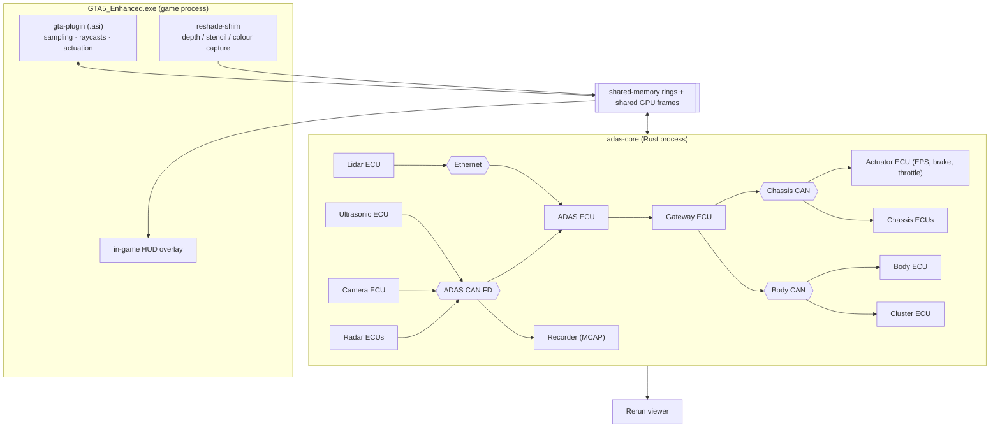

# GTA V Autopilot — PRD

2026-11-08 · Nick Peterson

## Overview

We are building a single-player GTA V Enhanced mod that drives a car the way a production ADAS stack does: simulated sensors, a real CAN bus, ECUs, and an autopilot that reacts within 50 ms. Status: the architecture was settled on 2026-11-08 and all decisions are closed. Next is Phase 0, which starts with validation spikes (see the Implementation plan tab).

**The realism rule:** the autopilot never reads the game directly. It sees only what a sensor reports on the CAN bus, and it acts only through actuator commands on the bus. GTA's built-in AI driving is never used.

**Core language:** Rust, for predictable latency (no garbage collector) and safe multithreading. Small C++ shims are allowed only where a host API is C++-only (see Tech stack).

## Goals and non-goals

**Goals**

- **G1. Realistic signal chain:** sensors, then CAN, then ECUs, then actuators, with the timing, noise and failure modes a real car has.
- **G2. Reactive:** under 50 ms from sensor to actuator; staged, decisive responses with no visible lag.
- **G3. Toggleable:** every sensor and every feature can be switched on or off live, and the car degrades the way a real one would.
- **G4. Observable:** you can see what the car sees: overlays, a bird's-eye view, point clouds, a live CAN trace.
- **G5. No game impact:** the mod adds under 1 ms to the game thread per frame.
- **G6. Replayable:** sensor and CAN data are recorded, so the autopilot can be developed and tested without GTA running.

**Non-goals**

- GTA Online or FiveM (bans; BattlEye).
- Training networks from scratch. Fine-tuning a pretrained detector on GTA's auto-labeled frames is in scope (D7).
- Supporting Legacy as well as Enhanced. Legacy is only a fallback if spike S2 fails (D2).
- Motorcycles, aircraft, boats. Four-wheel road vehicles only.

## Experience

It should feel like a modern Level 2 car you can open up: engage, let it drive, and watch it think.

- **Engage and override:** one key engages autopilot (like a stalk pull). Any steering, brake or throttle input from you overrides it immediately, as in a real car. Takeover requests chime and flash.
- **Cluster/HUD:** set speed, following-gap bars, the lead-car icon, lane lines, blind-spot icons and warnings, drawn in-game.
- **Perception overlay:** detection boxes on the game view, the ACC target highlighted, lidar points colored by object type.
- **Bird's-eye view:** fused object tracks with predicted paths, sensor coverage cones, ultrasonic arcs, the planned path.
- **Engineering panel:** sensor and feature toggles, fault injection (drop the radar, blind the camera), the live CAN trace, and the latency readout.
- **Scenario mode:** spawn repeatable tests (a pedestrian steps out, a car cuts in, a stopped car around a bend) to tune features.

One hard limit shapes the views: GTA renders one camera at a time, so other camera angles are synthesized views, not extra game cameras.

## Feature and sensor requirements

Ten features are planned, built on six sensor types. Every feature declares which sensors it needs, so turning a sensor off disables or degrades exactly the features that depend on it.

### Features

| ID | Feature | Behavior | Needs | Phase |
| --- | --- | --- | --- | --- |
| F1 | Adaptive cruise (ACC) | Holds set speed; keeps a 1.0 to 2.5 s time gap to the lead car; stop-and-go | Front radar | 2 |
| F2 | Forward collision warning (FCW) | Chime and flash at TTC of about 2.5 s | Front radar or camera | 2 |
| F3 | Emergency braking (AEB) | Partial brake at TTC of about 1.6 s, full at about 0.9 s; vehicles, then pedestrians | Radar + camera (fused) | 2 / 5 |
| F4 | Blind spot detection (BSD) | Mirror icon; chime if you signal into an occupied lane | Rear corner radars | 3 |
| F5 | Rear cross-traffic alert (RCTA) | Warn, then brake, when reversing into crossing traffic | Rear corner radars | 3 |
| F6 | Park assist | Distance arcs and tone; low-speed auto-brake | Ultrasonics | 3 |
| F7 | Lane keeping (LKA) / lane centering | Nudge back at the lane edge; later, continuous centering | Map, then camera | 4 / 5 |
| F8 | Traffic light and stop sign response | Slow and stop for red lights | Camera (or map ground truth) | 5 |
| F9 | Lane change assist | Signal-triggered lane change once BSD is clear | Corner radars + lanes | 6 |
| F10 | Route autopilot | Follows a route with turns and intersections | All | 6 |

TTC = time to collision. Thresholds are starting values to tune in scenario mode.

### Sensors

| Sensor | Count | Range / field of view | Rate | Source (first version) | Upgrade path |
| --- | --- | --- | --- | --- | --- |
| Front radar | 1 | ~160 m, ±10° | 20 Hz | Game object lists + line-of-sight raycast, with noise | — |
| Corner radars | 4 | ~80 m, ~150° each | 20 Hz | Game object lists + raycast | — |
| Ultrasonics | 12 | ~5 m | 25 Hz | Short raycasts | — |
| Front camera | 1 | ~120 m, ~100° | 30 Hz | Object lists filtered to a field-of-view cone | Frame capture + fine-tuned detector on GPU |
| Forward lidar (solid-state) | 1 | ~200 m, ~120° × 25° | 10 Hz | Depth buffer resampled at beam angles; stencil gives labels; sent over Ethernet | — |
| 360° lidar (optional) | 1 | ~100 m, 16 beams × 360 steps | 5 Hz | Raycasts (~480 per frame) | — |
| Vehicle state | — | Speed, wheel speeds, yaw rate, steering angle, gear, RPM | 100 Hz | Game natives + memory reads | — |
| Map | — | Lane geometry, speed limits, junctions | On demand | GTA road network (path nodes) | — |

All ranges and rates are modelled on production sensors and are configurable. Every ground-truth sensor runs through the error model (D18): misses, false positives, noise, latency and weather. Ground truth is also recorded as the scoring oracle (D6).

## System architecture

The system is two processes joined by shared memory. The game process does the minimum: it samples the world, captures graphics and applies controls. Everything that thinks runs in a separate Rust process, talking over simulated vehicle buses (D9).

*System architecture: 2 processes, 4 vehicle networks + a gateway. Simplified from the diagram in the Claude Doc.*

Sensor ECUs publish on the ADAS CAN FD bus, or on the Ethernet channel for lidar. The ADAS ECU reads them and sends commands, which the gateway routes to the actuator ECUs on the chassis bus. Nothing reaches the car except through the buses.

### Buses

Four networks and a gateway, defined in one topology file (D17), mirror a modern car's wiring:

| Network | Type | Carries |
| --- | --- | --- |
| Chassis CAN | Classic CAN, 500 kbit/s; a real car's layout from opendbc | Wheel speeds, steering, brakes, powertrain, driver inputs, actuator commands |
| ADAS CAN FD | CAN FD, 2 Mbit/s data phase | Radar object lists, camera objects and lanes, ultrasonics, ADAS status |
| Body CAN | Classic CAN, 125 kbit/s | Turn signals, hazard lights, cluster |
| Ethernet | Modelled 100 Mbit/s automotive Ethernet | Lidar point frames |
| Camera link | Point to point: a shared GPU texture | Raw frames to the camera ECU only |

- **Gateway:** routes only what each bus needs between buses, as real gateways do.
- **Frames:** one `.dbc` file per CAN bus; Rust message types are generated from them at build time.
- **Schedules:** each message has a real cycle time: wheel speeds and steering every 10 ms, camera every 33 ms, radar every 50 ms, cluster every 100 ms.
- **Bus model:** arbitration by ID, bit stuffing and load are computed per bus. An overloaded bus delays low-priority frames, as a real one does.
- **Integrity:** each frame has a rolling counter and checksum. A receiver that sees stale or invalid frames raises a fault, and the degradation matrix (D21) decides what becomes unavailable.
- **Faults:** the engineering panel can drop, delay, corrupt or silence any ECU or bus.
- **Export:** candump-format logs open in SavvyCAN and cabana.

### Timing model

- Every message carries two timestamps (D10): game time, which drives control, and a high-resolution wall clock, which measures latency and frame pacing.
- The game thread samples once per rendered frame.
- The core runs a fixed 100 Hz tick on game time. Each ECU runs on its own cycle, derived from that tick.
- When the game pauses, the core pauses; in slow motion, the core slows with it. Spike S1 checks how GTA's timer behaves in both.
- Each actuator command carries the tick it was computed on. The plugin applies the newest command every frame. If no fresh command arrives for 100 ms, it releases the throttle and alerts the driver.

## Performance requirements

The binding target: radar-driven reactions within 30 ms and camera-driven reactions within 50 ms (99th percentile), while costing the game under 1 ms per frame. Starting targets, assuming 60 fps:

**Target hardware:** a dedicated gaming PC with an RTX 4070 Ti (12 GB VRAM) and a Ryzen 7 7800X3D (8 cores, 16 threads). VRAM is the tightest resource. Proposed split: the game gets at most 9 GB, the detector, TensorRT workspace and lidar buffers get 2 GB, and 1 GB is margin.

| Budget | Target | Measured how |
| --- | --- | --- |
| Game-thread cost (sampling + actuation) | ≤ 1.0 ms per frame | Timer around the game-script tick |
| GPU cost (depth/stencil copy + capture) | ≤ 0.5 ms per frame | GPU timestamp queries |
| Detector inference | ≤ 8 ms at 30 Hz | Timer in the perception worker |
| Core tick | 100 Hz fixed; ≤ 3 ms of work per tick | Tick timer |
| Radar path: sample to actuator applied | ≤ 30 ms (99th percentile) | Timestamps carried end to end |
| Camera path: frame to actuator applied | ≤ 50 ms (99th percentile) | Timestamps carried end to end |
| Frame rate impact | ≤ 3% fps loss with everything on | Benchmark run, mod off vs on |
| Hitches | No frame over 2× the median caused by the mod | Frame-time trace |

Every message carries the game-time timestamp of its source sample, so the latency readout in the engineering panel is measured, not estimated.

## Tech stack

Rust everywhere we write logic. C++ appears only as a thin shim where a host API is C++-only, and the shim does no logic.

| Layer | Choice | Notes |
| --- | --- | --- |
| Game access | Script Hook V (Enhanced build), crate `shv-sys` | Thin bindings to its C exports (`scriptRegister`, `nativeInit`/`nativePush64`/`nativeCall`, `worldGetAllVehicles`); typed native wrappers generated at build time from a community native database |
| Edition-specific code | crate `gta-edition` | Memory patterns and offsets per game build; the only place Enhanced and Legacy differ (D2) |
| Graphics hook | ReShade add-on + C++ shim (D3) | Fixed C interface; a pure-Rust DX12 hook (`windows`, `retour`, `hudhook`) can replace it behind that interface. Windows screen capture is the camera-only fallback |
| In-game overlay | ReShade's overlay | No second ImGui hook (D8) |
| IPC | Shared-memory rings (`windows` file mapping + atomics) | Lock-free, one writer per ring. GPU frames are shared as cross-process D3D12 resources with a shared fence (D4) |
| Buses | Own bus model; `can-dbc` parser + Rust types generated from `.dbc` files | CAN, CAN FD and Ethernet per the topology file (D17); candump export |
| Math, filters | `nalgebra` | Kalman filters; ISO 8855 transforms (D16) |
| GPU inference | `ort` with TensorRT | Apache-licensed detector (D7) as ONNX, built into a TensorRT engine for the RTX 4070 Ti |
| Training (offline) | Python + PyTorch | The one non-Rust tool: fine-tunes on auto-labeled frames and exports ONNX |
| Live views | Rerun | Point clouds, bird's-eye view, camera, plots, CAN trace |
| Recording / replay | MCAP (`mcap` crate); Foxglove optional | One file per drive; replay tests on every build (D20) |
| Build | Cargo workspace + `xtask`, MSVC toolchain | The ASI is a `cdylib` renamed `.asi`; the shim builds with the `cc` crate |

**Rust-specific rules:** no panic may cross into the game (catch at every exported function); no allocation or blocking on the game thread; the in-game DLL stays small and changes rarely.

## Known constraints

These are facts about the platform that we design around, not decisions.

| Constraint | Impact | How we handle it |
| --- | --- | --- |
| One rendered camera at a time | No real side or rear camera feeds | Side and rear coverage comes from radar and ultrasonics; other views are synthesized (bird's-eye view, point clouds) |
| Script Hook V must match the game build | Every GTA patch breaks the mod until Script Hook V updates | Keep a backup of a working game version; turn off auto-updates while developing |
| BattlEye on Enhanced | Mods and ReShade only run with BattlEye off | Launch story mode with `-nobattleye`; never load the mod online |
| Game scripts run once per rendered frame | Sensor sampling rate depends on fps | The core runs its own fixed 100 Hz clock; samples are timestamped and the core interpolates |
| Raycasts are budgeted and asynchronous | A few hundred per frame; results arrive a frame later | Sensors share one ray budget; 360° lidar is low-resolution |
| Collision shapes are coarse | Raycasts see pedestrians as capsules and can miss distant vehicles | Precise sensing uses the depth buffer; raycasts only for short-range and coarse sensors |
| DX12 GPU readback costs 1 to 2 frames | Copying frames to the CPU adds latency | Keep frames on the GPU; run the detector there |
| Steering input is filtered by the game | Controller input passes through GTA's own steering smoothing and speed-sensitive lock | Steering angle is written through our EPS model instead (D5); S4 and S5 validate it |
| Enhanced memory layout differs from Legacy | Public vehicle-memory offsets (wheel speeds, steering angle) may be wrong | Find offsets per build by pattern scanning; spike S5 |
| GTA road data is a coarse node graph | No true lane-level map | Fit lanes from nodes plus lane counts; the camera provides real lane lines later |
| AI traffic and pedestrians act unpredictably | Good for realism, bad for repeatable tests | Scenario mode spawns scripted actors with fixed behavior |
| Pedestrian bodies are simple; no separate cyclist class | Weaker classification realism | Accept it; label cyclists from the vehicle model |

## Decision log

All 21 decisions are closed. The design-review recommendations were accepted on 2026-11-08, and D16 to D21 came out of that review. Spikes can still reopen a decision; each fallback is named in its row.

| ID | Decision | Choice | Fallback if a spike fails | Status | Applies from |
| --- | --- | --- | --- | --- | --- |
| D1 | Core language | Rust; C++ only inside the ReShade shim | — | Decided | Phase 0 |
| D2 | Game edition | Enhanced; all edition-specific code in one crate | Legacy (DX11) if S2 fails | Decided | Phase 0 |
| D3 | Graphics hook | ReShade add-on behind a fixed C interface; Windows screen capture as a camera-only fallback | Pure-Rust DX12 hook behind the same interface | Decided | Phase 0 |
| D4 | Where the autopilot runs | Separate process over shared memory; GPU frames shared across processes with a shared fence | — | Decided | Phase 0 |
| D5 | How controls are applied | Pedals by simulated input; steering angle written to memory through a modelled power-steering (EPS) unit; player controls blocked and read as driver input | Simulated steering input if S5 finds no stable offset | Decided | Phase 0 |
| D6 | Ground truth vs vision | Ground truth through Phase 4, always through the error model (D18); ground truth recorded as a scoring oracle | — | Decided | Phase 2 |
| D7 | Vision models | Apache-licensed detector (YOLOX or RT-DETR) fine-tuned on GTA auto-labels; map lanes as baseline; openpilot lane model as an experiment | Pretrained weights without fine-tuning | Decided | Phase 5 |
| D8 | Where views live | In-game overlay through ReShade; Rerun for live engineering views; Foxglove optional for replays | — | Decided | Phase 1 |
| D9 | Bus design | Chassis CAN with a real car's layout from opendbc; ADAS CAN FD for radars and camera; body CAN; Ethernet channel for lidar; gateway ECU | — | Decided | Phase 1 |
| D10 | Time model | Game time and a high-resolution wall clock on every message | — | Decided | Phase 0 |
| D11 | Engagement and override | openpilot-style rules, thresholds per input device, escalating takeover requests ending in a controlled stop | — | Decided | Phase 2 |
| D12 | Target PC | Separate gaming PC: RTX 4070 Ti (12 GB) + Ryzen 7 7800X3D. Not the Docker server. | — | Decided | Phase 0 |
| D13 | openpilot | Borrow its pieces now (bus layouts, rules, tuning); running it whole is a Phase 6 option under WSL2 on the gaming PC | — | Decided | Phase 1 |
| D14 | Release | Private until Phase 3; permissively licensed dependencies only | — | Decided | Phase 3 |
| D15 | Steering wheel and pedals | Later; override is designed around a driver-torque signal now | — | Deferred | Phase 6 |
| D16 | Coordinate frames and units | ISO 8855 (x forward, y left, z up), SI units; converted once at the plugin boundary | — | Decided | Phase 0 |
| D17 | Bus topology | One topology file defines every bus, ECU and gateway route | — | Decided | Phase 1 |
| D18 | Sensor error model | Misses, false positives, noise, latency and weather per sensor, with datasheet parameters | — | Decided | Phase 2 |
| D19 | Vehicle dynamics | Automatic calibration drive fits a model per car | Hand-tuned profiles for a few cars | Decided | Phase 2 |
| D20 | Testing | Replay tests on every build without GTA; scenario suite before each phase gate | — | Decided | Phase 0 |
| D21 | Degradation behavior | One matrix: each sensor fault → features unavailable → what the driver sees | — | Decided | Phase 2 |

A critique of every decision, with alternatives: [Design review](design-review.md)

## Risks and validation spikes

Seven throwaway experiments, about 8 to 11 days in total, turn the biggest unknowns into facts before real code starts. S1 to S6 run in Phase 0 and S7 in Phase 1. A failed spike triggers the fallback named in the decision log.

| ID | Spike | Pass when | Effort | Closes |
| --- | --- | --- | --- | --- |
| S1 | Rust `.asi` on Script Hook V for Enhanced: load, call natives, read speed, draw text | Runs 10 minutes on the current Enhanced build with no crash; game-timer behavior in pause and slow motion recorded (D10) | 1 day | Rust feasibility |
| S2 | Read depth and stencil on Enhanced through a ReShade add-on | Depth at a measured distance within ±2%; stencil separates vehicles, pedestrians and world | 1 to 2 days | D3 |
| S3 | Shared-memory round trip between game and core | 99th-percentile round trip under 0.5 ms at 100 Hz | 0.5 day | D4 |
| S4 | Steering and pedal fidelity: step inputs via simulated input vs memory writes | Steering responds within one frame; lock vs speed measured | 1 to 2 days | D5 |
| S5 | Vehicle memory offsets on Enhanced (wheel speeds, steering angle) via pattern scan | Values match game behavior across 3 vehicles | 1 to 2 days | Vehicle-state sensor |
| S6 | Raycast budget | Rays per frame measured at 0.5 ms game-thread cost | 0.5 day | Lidar resolution |
| S7 | Share DX12 frames with the core process and CUDA, run the detector through `ort` + TensorRT | Under 8 ms per frame on the target GPU | 2 days | D4 GPU sharing (Phase 1) |

**Risks**

- **Game patches:** each one stops the mod until Script Hook V and our memory patterns are updated. *Mitigation:* pin a game version for development; keep all game-specific offsets in one module.
- **Depth access fails on Enhanced (S2):** this would block lidar and vision. *Fallback:* our own DX12 hook that tracks depth-buffer creation.
- **Rust–C++ boundary:** ReShade's API is C++. *Mitigation:* a shim of fewer than 300 lines with a C interface, and no logic.
- **Anti-cheat changes:** Rockstar could extend BattlEye to story mode. *Mitigation:* none beyond staying offline. Watch for it.
- **Scope:** 10 features is a lot. *Mitigation:* every phase ends with something you can drive.

## Milestones

Seven phases, each ending in something you can drive. No dates yet. All decisions are closed, so Phase 0 can start.

Tasks, effort estimates and repository layout for each phase: [Implementation plan](implementation-plan.md)

| Phase | Delivers | Gate |
| --- | --- | --- |
| 0 · Spikes + skeleton | Spikes S1 to S6, core drives the car end to end | Spikes S1 to S6 pass; a recorded drive replays without GTA |
| 1 · Buses + tooling | Buses + gateway, chassis ECUs, recorder, Rerun, overlay, GPU sharing (S7) | Live CAN trace; identical replay; S7 passes |
| 2 · Front radar | ACC, FCW, AEB | Smooth stop-and-go; stops in every scenario |
| 3 · Corner radars + ultrasonics | BSD, RCTA, park assist | All three pass their scenarios |
| 4 · Map lanes | LKA, lane centering | 10 min highway lane hold, no takeover |
| 5 · Vision + lidar | Detector, lidar, fusion | Camera features run on vision |
| 6 · Full autopilot | Routes, behaviour planner | City route, no takeover |

*Roadmap: 7 phases, each with a gate. Being re-scoped in issue #10.*

A phase starts only after the previous phase passes its gate. The gates are proposed targets to tune as we go.

## Sources

- [Script Hook V for Enhanced](https://www.dev-c.com/post/scripthookv-enhanced) · [July 2026 build notes](https://gamedecide.com/script-hook-v-july-2026-update/)
- [Script Hook V .NET Enhanced](https://github.com/Chiheb-Bacha/scripthookvdotnetenhanced)
- [LiDAR point cloud generator in GTA V (arXiv 1804.00103)](https://arxiv.org/pdf/1804.00103) · [PreSIL dataset paper (arXiv 1905.00160)](https://arxiv.org/pdf/1905.00160)
- [DeepGTAV](https://github.com/Ben93kie/DeepGTAV) · [Manual Transmission (ikt)](https://www.gta5-mods.com/scripts/manual-transmission-ikt)
- [openpilot in GTA V (Vice)](https://www.vice.com/en/article/teen-programmer-uses-real-self-driving-car-tech-in-gta-v) · [openpilot simulator docs](https://docs.comma.ai/tools/sim/README.html)
- [hudhook (Rust DX12 overlay hook)](https://docs.rs/crate/hudhook/0.6.5/source/README.md)
