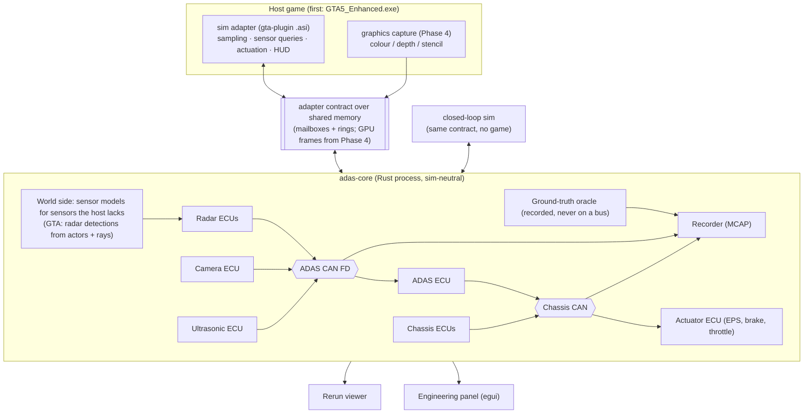

# GTA V Autopilot — PRD

2026-11-08 · Nick Peterson · revised 2026-11-09 (the sensor boundary, D30)

## Overview

We are building a driver-assistance and autopilot stack that drives a car the way a production ADAS stack does: simulated sensors, real CAN buses, ECUs, and an autopilot that reacts within two game frames. GTA V Enhanced (single-player) is the first host game. It is not the platform: everything that thinks is sim-neutral and talks to the game through one adapter, so the stack can move to BeamNG, CARLA or another sim by writing a new adapter (D22).

Status (2026-11-09): Phases 0–2 passed their gates. Phase 3 built lane centering, but its camera "saw" lanes laid out from GTA's road nodes, not from images, and its accuracy was scored against those same lanes. That broke the realism rule in spirit, so Phase 3 closes without its gate. Its controllers carry over; its perception is replaced. The plan is reordered around the sensor boundary (D30): the camera comes from images, a second host (CARLA, D31) arrives next to prove it, and lanes come from vision before any lane gate is claimed. Open decisions: the GTA forward camera (D29) and the lane perception method (D32), both needed in the next two phases (see the [Implementation plan](implementation-plan.md)).

**The realism rule:** the autopilot never reads the game directly. It sees only what a sensor reports on a CAN bus, and it acts only through actuator commands on the bus. The game's built-in AI driving is never used for the ego car.

**The sensor boundary (D30):** a host supplies only what a sensor's front end measures: camera images, radar detections, ultrasonic echoes, lidar points, and the car's own state as its CAN would carry it. Everything from there on (detection, classification, tracking, lanes) happens in the core's ECUs. Game data is never a sensor's "eyes". It is recorded beside the drive as the scoring oracle (D6), and it may feed a world-side sensor model only where a host lacks a sensor (GTA has no radar), as a sim's own sensor engine would.

**The CARLA test:** give the core a car's sensors in CARLA, and it drives the way it does in GTA, with no change outside the adapter. Every perception design is judged by whether it passes this test.

**The portability rule:** the core never depends on a game-specific trick. Anything game-specific (memory hooks, render tricks, game natives) lives inside that game's adapter, behind a sim-neutral contract.

**Core language:** Rust, for predictable latency (no garbage collector) and safe multithreading. Small C++ shims are allowed only where a host API is C++-only (see Tech stack).

## Goals and non-goals

**Goals**

- **G1. Realistic signal chain:** sensors, then CAN, then ECUs, then actuators, with the timing, noise and failure modes a real car has.
- **G2. Reactive:** at most 2 frames from sensor sample to applied actuator command (99th percentile); staged, decisive responses with no visible lag.
- **G3. Toggleable:** every sensor and every feature can be switched on or off live, and the car degrades the way a real one would.
- **G4. Observable:** you can see what the car sees: overlays, a bird's-eye view, point clouds, a live CAN trace.
- **G5. No game impact:** the adapter adds under 1 ms to the game thread per frame.
- **G6. Replayable and testable:** sensor and CAN data are recorded, and a closed-loop simulator tests the controllers without any game running.
- **G7. Portable:** moving to another sim means writing one adapter. The core, buses, ECUs and features don't change.
- **G8. Honest perception:** every ECU input is something a real sensor could measure, and every perception metric is scored against truth the car didn't use to drive (D6, D30).

**Non-goals**

- GTA Online or FiveM (bans; BattlEye).
- Training networks from scratch. Fine-tuning a pretrained detector on auto-labeled frames is in scope (D7).
- Supporting GTA Legacy as well as Enhanced. Legacy is only a fallback if spike S2 fails (D2).
- Motorcycles, aircraft, boats. Four-wheel road vehicles only.

## Experience

It should feel like a modern Level 2 car you can open up: engage, let it drive, and watch it think.

- **Engage and override:** one key engages autopilot (like a stalk pull). Driver input overrides it the way a real car does (D11). Takeover requests chime and flash.
- **Cluster/HUD (in-game):** set speed, following-gap bars, the lead-car icon, lane lines, a spotter ring for blind-spot and cross-traffic warnings. It shows what the sensors reported, not ground truth, so misses are visible.
- **Bird's-eye view (Rerun):** fused object tracks with predicted paths, sensor coverage cones, ultrasonic arcs, the planned path. Ground truth is a separate layer you can toggle.
- **Engineering panel (desktop window):** sensor and feature toggles, fault injection (drop the radar, blind the camera), the live CAN trace, and the latency readout (D8).
- **Scenario mode:** spawn repeatable tests (a pedestrian steps out, a car cuts in, a stopped car around a bend) to tune features (D27).
- **A current-gen camera.** The windshield camera reads lanes, vehicles, pedestrians, signs and lights from real images, like a current production camera (D26, D7). Until it does, the camera features are unavailable on a host, and the HUD says so.

## Feature and sensor requirements

Ten features are planned, built on six sensor types. Every feature declares which sensors it needs, so turning a sensor off, or running on a sim that lacks it, disables or degrades exactly the features that depend on it.

### Features

| ID | Feature | Behavior | Needs | Phase |
| --- | --- | --- | --- | --- |
| F1 | Adaptive cruise (ACC) | Holds set speed; keeps a 1.0 to 2.5 s time gap to the lead car; stop-and-go | Front radar | 1 |
| F2 | Forward collision warning (FCW) | Chime and flash at TTC of about 2.5 s | Front radar or camera | 1 |
| F3 | Emergency braking (AEB) | Partial brake at TTC of about 1.6 s, full at about 0.9 s; vehicles first, then pedestrians | Radar, then radar + vision camera (fused) | 1 / 5 |
| F4 | Blind spot detection (BSD) | Spotter-ring and mirror icon; chime if you signal into an occupied lane | Rear corner radars | 2 |
| F5 | Rear cross-traffic alert (RCTA) | Warn, then brake, when reversing into crossing traffic | Rear corner radars | 2 |
| F6 | Park assist | Distance arcs and tone; low-speed auto-brake | Ultrasonics | 2 |
| F7 | Lane keeping (LKA) / lane centering | Nudge back at the lane edge; then continuous centering along a driving path (lane lines, road edges, the lead car's trail) | Vision camera ECU (lanes) | 5 |
| F8 | Traffic light and stop sign response | Slow and stop for red lights and stop signs | Vision camera | 7 |
| F9 | Lane change assist | Signal-triggered lane change once BSD is clear | Corner radars + lanes | 7 |
| F10 | Route autopilot | Follows a route with turns and intersections | All, plus the navigation map | 7 |

TTC = time to collision. Thresholds are starting values to tune in the simulator and scenario mode. Lane control from Phase 3 (pure pursuit, the learned steering response, the lane checks) carries over to F7; only its perception changes.

**How lane control should feel.** Lane-centre error alone doesn't make it feel right. Lateral gates also measure lateral jerk (≤ 5 m/s³, as UNECE R79 allows for lane keeping), lateral acceleration (≤ 3 m/s², ISO 11270 and R79), weaving (no sustained oscillation about the lane centre), and overshoot leaving a bend.

### Sensors

| Sensor | Count | Range / field of view | Rate | How it is modelled | Later |
| --- | --- | --- | --- | --- | --- |
| Front radar | 1 | ~160 m, ±10° | 20 Hz | The host gives **detections**: range, azimuth, elevation, radial velocity and strength per return, for moving and static targets, with no class. The radar ECU clusters and tracks them. CARLA's radar is native; in GTA a world-side model makes detections from the actor list, line-of-sight rays and a ray budget for static returns, then the error model (D25, D30) | — |
| Corner radars | 4 | ~80 m, ~150° each | 20 Hz | Same as the front radar (D25) | — |
| Ultrasonics | 12 | ~5 m | 25 Hz | Echo distances from short ray fans | — |
| Front camera | 1 | ~120 m, ~100° | ≥ 20 Hz | The host gives **images** with the camera's pose and projection. The camera ECU detects lanes, road edges, vehicles, pedestrians and signs in them (D7, D26, D32) | — |
| Forward lidar (solid-state) | 1 | ~200 m, ~120° × 25° | 10 Hz | Points at beam angles: native in CARLA; in GTA from the depth buffer. Sent over Ethernet | Phase 6 |
| 360° lidar | — | — | — | Deferred (raycast cost) | — |
| Vehicle state | — | Speed, wheel speeds, yaw rate, steering angle, gear, RPM | Every game frame (about 60 Hz) | From the adapter, as the car's own CAN carries it | — |
| Navigation map | — | Road graph, lane counts, speed limits, junctions; no lane geometry | On demand | From the adapter (in GTA: path nodes). Like a car's satnav map: routes and speed-limit hints, never what the car steers along | — |

All ranges and rates are modelled on production sensors and are configurable. Every world-side sensor model runs through the error model (D18): misses, false positives, clutter, noise, latency and weather. Ground truth is recorded beside the drive as the scoring oracle (D6) and never reaches an ECU.

**Truth for scoring lanes.** GTA has no lane data, so its lanes need a separate truth: a hand-labelled set of frames from a named route, plus where AI traffic drives. CARLA's map gives exact lane truth. Map lanes laid out from GTA's road nodes are an overlay to compare against, not truth.

## System architecture

The system is two processes joined by shared memory: the **adapter**, which lives in the game, and the **core**, which does all the thinking. The adapter does the minimum: it samples the world, answers standing sensor queries, draws the HUD and applies controls. The core is sim-neutral and talks to its ECUs over simulated vehicle buses (D9).

*Architecture from Phase 4 (D30). Raw sensor data from the host (images, radar detections, echoes) goes straight to the car-side ECUs; the world side only fills in for sensors the host lacks. Camera frames join in Phase 4; body CAN, a gateway and Ethernet lidar in Phase 6 (D9).*

Sensor ECUs publish on the ADAS CAN FD bus. The ADAS ECU sits on both buses, as front-camera ADAS units do in real cars: it reads sensors on ADAS CAN FD and sends actuator commands on chassis CAN. Nothing reaches the car except through the buses.

### Sim adapter

The core never knows which game it is driving. It talks to one adapter contract (D22), defined as versioned messages, so an adapter can be written in any language. Every adapter does the one coordinate conversion into ISO 8855 vehicle frames and SI units (D16).

| Capability | What the adapter provides | Required? |
| --- | --- | --- |
| Vehicle state | Speed, wheel speeds, yaw rate, steering angle, gear, RPM, pose | Yes |
| Controls | Applies a steering angle, throttle and brake; reports the raw driver inputs separately | Yes |
| Camera frames | Colour images for a sensor camera, with its exact pose and projection; depth and labels where the host has them (for lidar and auto-labels) | Optional (needed for every camera feature) |
| Radar detections | Per radar mount: returns with range, angles, radial velocity and strength | Optional. A host without radar supplies ground-truth actors instead, and the world-side radar model makes the detections |
| Range fans | For a standing set of ray fans: hit distance per ray | Optional (needed for ultrasonics, and for static radar returns in hosts without radar) |
| Navigation map | Road graph, lane counts, speed limits, junctions near the car | Optional (routes, speed-limit hints) |
| Ground truth | Nearby vehicles and pedestrians (ID, class, pose, velocity, size), line of sight from each sensor mount, and lane truth where the host has it | Optional. Recorded as the oracle; feeds only world-side sensor models and scenarios, never an ECU (D30) |
| Scenario primitives | Spawn, give a task, drive an actor along a fixed profile, teleport, set weather and time, freeze | Optional (needed for scenario mode) |
| HUD | Draws the HUD state the core sends | Optional |

On connect, the adapter declares its capabilities. A missing capability is handled by the degradation matrix (D21), exactly like a failed sensor. Sensor queries are *standing*: the core sends the sensor layout once, and the adapter answers every frame with no request round trip.

Inside the core, a crate boundary separates the **world side** (world-side sensor models, which turn a host's ground truth into raw sensor data only for sensors the host lacks) from the **car side** (ECUs, fusion, features, control), which sees only raw sensor data and bus messages. The closed-loop simulator, which renders no images, may hand the car side ideal camera output directly. It is a bench for the controllers, labelled as such, and no perception gate is scored on it.

Candidate hosts:

| Host | Fit | Notes |
| --- | --- | --- |
| GTA V Enhanced | First host | Steering needs a per-frame memory write inside the adapter (D5); the camera needs a render workaround (D29); radar comes from the world-side model |
| Closed-loop sim (ours) | Built in Phase 1 | Implements the same contract; a controller bench without images (D20) |
| CARLA | Second host (D31) | Built for ADAS research: native cameras, radar detections, lidar, semantic labels with lane markings, exact lane truth from its map, a scenario API. The CARLA test runs here |
| BeamNG.drive | Good | Built-in radar, lidar, camera and ultrasonic sensors, and a control API |
| iRacing | Poor | No world positions for other cars, controls only through a virtual joystick, and automated driving likely breaks its terms of service |

### Buses

Two networks from Phase 1, defined in one topology file (D17), with more later:

| Network | Type | Carries | From |
| --- | --- | --- | --- |
| Chassis CAN | Classic CAN, 500 kbit/s; Toyota TSS2 layout from opendbc | Wheel speeds, steering, brakes, powertrain, driver inputs, actuator commands | Phase 1 |
| ADAS CAN FD | CAN FD, 2 Mbit/s data phase | Radar object lists, camera objects, lanes and signs, ultrasonics, ADAS status | Phase 1 |
| Body CAN + gateway | Classic CAN, 125 kbit/s | Turn signals, hazard lights, cluster | Phase 6 |
| Ethernet | Modelled 100 Mbit/s automotive Ethernet | Lidar point frames | Phase 6 |
| Camera link | Point to point: shared GPU frames | Raw frames to the camera ECU only | Phase 4 |

- **Frames:** one `.dbc` file per CAN bus; Rust message types are generated from them at build time.
- **Schedules:** each message has a real cycle time: wheel speeds and steering every 10 ms, camera every 33 ms, radar every 50 ms, cluster every 100 ms.
- **Bus model:** arbitration by ID, bit stuffing and load are computed per bus. An overloaded bus delays low-priority frames, as a real one does.
- **Integrity:** each frame has a rolling counter and checksum. A receiver that sees stale or invalid frames raises a fault, and the degradation matrix (D21) decides what becomes unavailable.
- **Faults:** the engineering panel can drop, delay, corrupt or silence any ECU or bus.
- **Export:** candump-format logs open in SavvyCAN and cabana.

### Timing model

Timing is counted in game frames, because the game produces one sample per rendered frame (D23).

- **Clocks on every message (D10):** a frame counter; game time in µs, accumulated from each frame's delta time (GTA's game timer only has ms resolution); and a high-resolution wall clock (QueryPerformanceCounter) for latency and frame pacing.
- **One core step per sample.** Each sample triggers one `step()`. Inside it, every ECU runs in data-flow order (sensor ECUs, then the buses, then the ADAS ECU, then the actuator ECU), so a sample's effect reaches the actuators in the same step.
- **Per frame, the adapter:** reads the newest command; applies it (or the safe state, D24); samples vehicle state, actors, driver input and the sensor-query answers; writes the sample; draws the HUD.
- **Latency mode:** `reactive` delivers bus messages within the step. `realistic` gives every message a delivery time from its cycle time and the bus model; a message due after the step ends is delivered in a later step. Production radar-to-brake chains take about 100 ms or more, so realistic mode feels slower on purpose.
- **Deterministic:** `step()` reads no wall clock and depends on no thread timing. Replays of ground-truth drives produce identical bus traffic.
- **Pause and slow motion:** when the game pauses, no samples arrive and the core waits. In slow motion, frame deltas shrink and the core slows with them. Spike S1 confirms how GTA's timers behave in both.
- **Commands carry the sample number they answer.** That doubles as the heartbeat for the watchdog (D24) and as the latency probe.

### Safety and safe states

The adapter enforces the safe state, because the core may be the thing that failed (D24).

| Situation | Detected by | What happens |
| --- | --- | --- |
| Core stalls or crashes: no fresh command for 6 frames (about 100 ms of game time) | Adapter watchdog | Steering write stopped at once (the player steers); throttle released; brake ramped down over about 1 s, or held to a stop if AEB was braking; "TAKE OVER" on the HUD with a chime |
| Game paused, menu open, loading screen | Adapter | Watchdog paused; the core is told it is paused |
| Cutscene, ego car lost or changed | Adapter | Disengage; hand back to the player |
| Core restarts | Epoch counter on the contract | The core always starts disengaged; it never re-engages on its own |
| Driver override | Core (D11) | Brake cancels everything; gas pauses speed control; steering pauses lane-keeping |
| Driver ignores a takeover request | Core (D11) | Escalates from visual to chime to a controlled stop with hazards |
| Stale or invalid bus frames | Receiving ECU | Degradation matrix (D21) |
| Game crashes | Core (no samples) | Core stops stepping; the recorder closes the file cleanly |

Phase 0 test: kill the core mid-turn and mid-brake; the player regains control within 2 frames.

## Performance requirements

The binding target: at most 2 frames from sample to applied command for radar-driven reactions (99th percentile, reactive mode), while costing the game under 1 ms per frame.

**Target hardware:** a dedicated gaming PC with an RTX 4070 Ti (12 GB VRAM) and a Ryzen 7 7800X3D (8 cores, 16 threads). VRAM is the tightest resource. Guideline split: the game about 9 GB, the detector, TensorRT workspace and lidar buffers 2 GB, and 1 GB of margin. The game's share can't be enforced; ReShade and the Rerun viewer also use the GPU, so Rerun's memory limit is capped.

| Budget | Target | Measured how |
| --- | --- | --- |
| Adapter game-thread cost | ≤ 1.0 ms per frame | Timer around the game-script tick |
| Core step | ≤ 5 ms (99th percentile) | Step timer |
| Radar path: sample to command applied | ≤ 2 frames (99th percentile, reactive mode) | Sample number echoed in each command |
| Camera path (Phase 4 on): frame to command applied | ≤ 3 frames (99th percentile) | Frame counter carried end to end |
| GPU cost of capture (Phase 4 on) | ≤ 0.5 ms per frame | GPU timestamp queries |
| Detector inference (Phase 5 on) | ≤ 8 ms at 30 Hz | Timer in the perception worker |
| Frame rate impact | ≤ 3% fps loss without the sensor camera. The sensor camera has its own budget (S2b) | Benchmark run, mod off vs on |
| Hitches | No frame over 2× the median caused by the mod | Frame-time trace |

## Tech stack

Rust everywhere we write logic. C++ appears only as a thin shim where a host API is C++-only, and the shim does no logic.

| Layer | Choice | Notes |
| --- | --- | --- |
| Adapter contract | crate `adapter-api` | Versioned message schema, capabilities, mailboxes and rings; sim-neutral (D22) |
| GTA access | Script Hook V (Enhanced build), crate `shv-sys` | Thin bindings to its C exports (`scriptRegister`, `nativeInit`/`nativePush64`/`nativeCall`, `worldGetAllVehicles`); typed native wrappers generated at build time from a community native database |
| GTA edition-specific code | crate `gta-edition` | Memory patterns, offsets and the steering write per game build; the only place Enhanced and Legacy differ (D2, D5) |
| GTA graphics hook (Phase 4) | ReShade with **full add-on support**, version pinned, + C++ shim (D3) | Fixed C interface; a pure-Rust DX12 hook can replace it behind that interface |
| In-game HUD | Drawn by the adapter; in GTA with Script Hook V draw natives | No dependency on ReShade (D8) |
| Engineering panel | `egui` window in the core (`ui` crate) | Hot-reloads with the core (D8) |
| IPC | Shared memory (`windows` file mapping + atomics) | Latest-value mailboxes (seqlock) for samples, commands and HUD state; lossless SPSC rings for scenario commands and replies; GPU frames copied into a shared ring with a shared fence (D4) |
| Buses | Own bus model; `can-dbc` parser + Rust types generated from `.dbc` files | Per the topology file (D17); candump export |
| Math, filters | `nalgebra` | Kalman filters; ISO 8855 transforms (D16) |
| GPU inference (Phase 5) | `ort` (pin the exact 2.0 release candidate) with TensorRT | Apache-licensed detector as ONNX: lyuwenyu/RT-DETR (Apache-2.0, not the AGPL Ultralytics build) or YOLOX (D7) |
| Training (offline) | Python + PyTorch | The one non-Rust tool: fine-tunes on auto-labeled frames and exports ONNX |
| Live views | Rerun | Bird's-eye view, point clouds, camera, plots, CAN trace |
| Recording / replay | MCAP (`mcap` crate); Foxglove optional | One file per drive (D20) |
| Build | Cargo workspace + `xtask`, MSVC toolchain | The GTA adapter is a `cdylib` renamed `.asi`; the shim builds with the `cc` crate |

**Rust-specific rules:** no panic may cross into the game (catch at every exported function); no allocation or blocking on the game thread; adapters stay small and change rarely.

## Known constraints

These are facts about the platforms that we design around, not decisions. Most are GTA-specific and handled inside the GTA adapter.

| Constraint | Impact | How we handle it |
| --- | --- | --- |
| GTA renders one camera at a time | No extra camera views for free | Side and rear sensing uses radar detections, as real corner radars do (D25); the forward camera is solved in Phase 4 (D29) |
| GTA has no radar | Radar data must be made, not read | A world-side model makes detections from actors, line-of-sight rays and a ray budget for static returns (D25, D30, S9). Hosts with native radar skip it |
| Script Hook V must match the game build | Every GTA patch breaks the adapter until Script Hook V updates | Keep a backup of a working game version; turn off auto-updates while developing |
| BattlEye on Enhanced and Legacy | Mods and ReShade only run with BattlEye off | Launch story mode with `-nobattleye`; never load the mod online |
| Game scripts run once per rendered frame | Sample rate depends on fps | The core steps once per sample and counts time in frames (D23) |
| GTA raycasts are budgeted | Only a limited number of rays per frame | Radars use actor lists plus one or two line-of-sight rays per actor; ray fans only for ultrasonics; 360° lidar deferred (D25) |
| GTA collision shapes are coarse | Raycasts see pedestrians as capsules | Precise sensing uses the depth buffer in Phase 6 |
| DX12 GPU readback costs 1 to 2 frames | Copying frames to the CPU adds latency | Keep frames on the GPU; run the detector there |
| GTA recomputes the steering angle every frame | Writing the angle field doesn't hold (S4) | Write the smoothed steering input instead, every frame, with an integral correction on the measured angle; 1-frame lag on 4 vehicles (D5) |
| Blocked controls ignore simulated input (S4) | We can't block the player and inject at the same time | Inject unblocked; read the driver's keyboard and gamepad from Windows (D5) |
| Holding the brake at a standstill reverses the car (S4) | Emergency braking would end in reverse | The adapter holds a standstill with the handbrake native, like an auto-hold (D5) |
| Enhanced memory layout differs from Legacy | Public vehicle-memory offsets may be wrong | Find offsets per build by pattern scanning; spike S5 |
| GTA road data is a coarse node graph | No true lane-level map, and no lane truth to score against | Used only as a navigation map; lanes come from vision (Phase 5). Lane truth in GTA is a hand-labelled frame set plus AI traffic's positions |
| AI traffic and pedestrians act unpredictably | Good for realism, bad for repeatable tests | Scenario actors can be driven along fixed profiles (D27) |
| Pedestrian bodies are simple; no separate cyclist class | Weaker classification realism | Accept it; label cyclists from the vehicle model |

## Decision log

Spikes can still reopen a decision; each fallback is named in its row. D22–D29 and the changes to D3, D5, D7–D10, D19 and D20 come from the second design review (issues #1–#11), accepted on 2026-11-08. D30–D32 and the changes to D6, D7, D18, D25, D26 and D29 come from the realism review of 2026-11-09, after Phase 3's camera turned out to read lanes from game data.

| ID | Decision | Choice | Fallback if a spike fails | Status | Applies from |
| --- | --- | --- | --- | --- | --- |
| D1 | Core language | Rust; C++ only inside the ReShade shim | — | Decided | Phase 0 |
| D2 | First host game | GTA V Enhanced; all edition-specific code in `gta-edition` | Legacy if S2 fails | Decided | Phase 0 |
| D3 | GTA graphics hook | ReShade (full add-on support, pinned) behind a fixed C interface; Windows screen capture as a colour-only fallback | Pure-Rust DX12 hook behind the same interface | Decided | Phase 4 |
| D4 | Where the autopilot runs | Separate process over shared memory; GPU frames copied by the shim into its own shared ring, with a shared fence (#5) | CPU readback for prototyping | Decided | Phase 0 |
| D5 | GTA controls | Steering: write the vehicle's smoothed steering input every frame while engaged (offset found per build); the core still sends an angle; the adapter converts it to that input with a per-vehicle ratio measured at engage. Pedals: simulated input on unblocked controls, mapped through GTA's 25% deadzone. Driver input read from the keyboard and gamepad through Windows, not the game. Standstill hold by the handbrake native, the adapter's auto-hold (#4, changed after S4 and S5) | Steering: a signature-scanned code hook with an engage flag if the write misbehaves; pedals by memory write | Decided | Phase 0 |
| D6 | Ground truth | Recorded beside every drive as the scoring oracle. It never feeds an ECU; it may feed a world-side sensor model only for a sensor the host lacks (D30). Every perception metric is scored against truth the car didn't drive on. Changed 2026-11-09: before, the camera ECU's eyes were ground truth through Phase 4 | — | Decided | Phase 1 |
| D7 | Vision models | Objects: an Apache-licensed detector (lyuwenyu/RT-DETR or YOLOX) fine-tuned on auto-labels from the stencil buffer (GTA) and semantic labels (CARLA), aiming at current-gen camera capability: vehicles, pedestrians, signs, lights. Lanes: by D32, because the stencil buffer doesn't label lane paint | Pretrained weights without fine-tuning | Decided | Phase 5 |
| D8 | Where views live | In-game HUD drawn by the adapter (GTA: Script Hook V natives); engineering panel as an egui window in the core; Rerun for live views; Foxglove optional for replays (#8) | — | Decided | Phase 1 |
| D9 | Bus design | Chassis CAN (Toyota TSS2 layout from opendbc) and ADAS CAN FD from Phase 1, with the ADAS ECU on both; body CAN + gateway and Ethernet for lidar in Phase 6 | — | Decided | Phase 1 |
| D10 | Time model | Frame counter, game time accumulated from frame deltas (µs), and a QPC wall clock on every message | — | Decided | Phase 0 |
| D11 | Engagement and override | openpilot-style rules, thresholds per input device, escalating takeover requests ending in a controlled stop | — | Decided | Phase 1 |
| D12 | Target PC | Separate gaming PC: RTX 4070 Ti (12 GB) + Ryzen 7 7800X3D | — | Decided | Phase 0 |
| D13 | openpilot | Borrow its pieces now (bus layouts, rules, tuning); running it whole is a Phase 7 option under WSL2 | — | Decided | Phase 1 |
| D14 | Release | Private until Phase 2; permissively licensed dependencies only. Reviewed at the end of Phase 2 (2026-11-09): stays private for now | — | Decided | Phase 2 |
| D15 | Steering wheel and pedals | Later; override is designed around a driver-torque signal now | — | Deferred | Phase 7 |
| D16 | Coordinate frames and units | ISO 8855 (x forward, y left, z up), SI units; converted once inside each adapter | — | Decided | Phase 0 |
| D17 | Bus topology | One topology file defines every bus, ECU and route | — | Decided | Phase 1 |
| D18 | Sensor error model | For world-side sensor models: misses, false positives, clutter and ghost returns, noise, latency and weather per sensor, with datasheet parameters. Native host sensors bring their own | — | Decided | Phase 1 |
| D19 | Vehicle dynamics | Hand-tuned profiles for two cars first; the steering response is learned on line per speed band and saved in the profile; an automatic calibration drive later | — | Decided | Phase 1 / 6 |
| D20 | Testing | Closed-loop simulator on every build; replay of recordings (identical bus traffic claimed for ground-truth replays only); in-game scenario suite at each phase gate (#6) | — | Decided | Phase 0 |
| D21 | Degradation behavior | One matrix: each sensor fault or missing adapter capability → features unavailable → what the driver sees | — | Decided | Phase 1 |
| D22 | Sim adapter | The core talks only to a sim-neutral, versioned adapter contract; adapters declare capabilities; all game-specific code stays in the adapter | — | Decided | Phase 0 |
| D23 | Timing | One core step per game frame; ECUs in data-flow order; latency budget in frames; `reactive` or `realistic` latency mode (#3) | — | Decided | Phase 0 |
| D24 | Safe state | Adapter-side watchdog hands control back to the driver; brake held to a stop only if AEB was braking (#7) | — | Decided | Phase 0 |
| D25 | Radar and side/rear sensing | Hosts give radar detections (D30); radar ECUs cluster and track them and publish object lists. In GTA, the world-side model makes detections from the actor list, line-of-sight checks and a ray budget for static returns, then the error model. Ultrasonics: ray fans. 360° lidar deferred (#2). Changed 2026-11-09: before, radar ECUs took the actor list directly | Fixed ray fans per radar | Decided | Phase 1 / 4 |
| D26 | Camera ECU | Publishes lanes, road edges, objects and signs on ADAS CAN FD, like a production camera, from images only. A host without camera frames has no camera features. Changed 2026-11-09: Phase 3's ground-truth camera is retired on hosts; it survives only in the closed-loop sim as a controller bench | — | Decided | Phase 5 |
| D27 | Scenarios | Run by the core from `scenarios/*.toml`; the adapter exposes primitives; actors can follow fixed profiles for repeatability (#9) | — | Decided | Phase 1 |
| D28 | Steering command type | Angle, using the TSS2 DBC's `STEERING_LTA` message (confirm it in the DBC); the EPS model limits angle rate and range; driver torque estimated for override (#4) | — | Decided | Phase 1 |
| D29 | GTA forward sensor camera | Spike S2b tries frame interleaving; fallbacks: the player's own camera as the sensor, or a forced hood view (#1). Now first in line: every camera feature waits on it | — | Open | Phase 4 |
| D30 | The sensor boundary | Hosts give raw sensor data only (images, radar detections, echoes, points, the car's own state). ECUs do all detection and tracking. Ground truth is the oracle, and feeds only world-side models for sensors a host lacks. The core is split by crate into a world side and a car side. The closed-loop sim may give ideal camera output as a labelled controller bench | — | Decided | Phase 4 |
| D31 | Second host | CARLA, brought forward to Phase 4 so that the sensor boundary is built against two hosts at once, and the vision camera can be developed on CARLA's native camera while GTA's (D29) is settled. Replaces the earlier proposal of BeamNG in Phase 4 | BeamNG.drive | Decided | Phase 4 |
| D32 | Lane perception | Spike S8 compares openpilot's driving model (MIT; lane lines, road edges and a path from frames), a pretrained lane detector, and one trained on CARLA's lane-marking labels; scored on CARLA against its map and on a hand-labelled GTA set; keep the best | A classical fit (edges and lines) | Open | Phase 5 |

A critique of the first set of decisions: [Design review](design-review.md). The second review lives in the GitHub issues.

## Risks and validation spikes

Throwaway experiments turn the biggest unknowns into facts before real code depends on them. S1 and S3–S6 ran in Phase 0; S2b, S7 and S9 run at the start of Phase 4; S8 at the start of Phase 5; S2 at the start of Phase 6. A failed spike triggers the fallback named in the decision log.

| ID | Spike | Pass when | Closes |
| --- | --- | --- | --- |
| S1 | Rust `.asi` on Script Hook V for Enhanced: load, call natives, read speed, draw text | Runs 10 minutes with no crash; game timer and frame-time behavior in pause and slow motion recorded; whether shape tests can return in the same tick | Rust feasibility, D10, D23 |
| S3 | Shared-memory round trip between adapter and core | 99th-percentile round trip under 0.5 ms at 60 and 144 fps | D4 |
| S4 | Steering write and pedals: hold an angle by the per-frame write; drive pedals by simulated input; hold the car at a standstill | Angle holds and tracks a changing command on 3 vehicles; pedal mapping measured; standstill hold works | D5 |
| S5 | Vehicle memory offsets on Enhanced (wheel speeds, steering angle) via pattern scan | Values match game behavior across 3 vehicles | Vehicle-state capability |
| S6 | Ray budget | Cost of line-of-sight checks for 4+1 radars in heavy traffic and of the ultrasonic fans, within 0.5 ms per frame; whether parked vehicles appear in the actor list | D25 |
| S2 | Read depth and stencil on Enhanced through a ReShade add-on | Depth at a measured distance within ±2%; stencil separates vehicles, pedestrians and world; frame alignment within 2 px at 30 m/s | D3 |
| S2b | Hidden forward sensor camera by frame interleaving | No visible flicker or LOD pop over a 10-minute drive; 1% low frame time within 1.5× median; fps cost ≤ 40%; camera ≥ 20 Hz with matching matrices | D29 |
| S7 | Share frames with the core process and CUDA; run the detector through `ort` + TensorRT | Under 8 ms per frame on the target GPU | D4 GPU sharing |
| S8 | Lane perception on host frames: openpilot's driving model, a pretrained lane detector, one trained on CARLA labels | The ego lane's lines within 0.2 m RMS at 20 m ahead, on CARLA (against its map) and on a hand-labelled GTA set; within the inference budget | D32 |
| S9 | Static radar returns in GTA: a ray budget per radar for walls, guardrails, fences and parked cars | Finds the airport perimeter fence and a guardrail at 60 m; all radars within 0.5 ms per frame with S6's line-of-sight checks | D25 |

S4 and S5 are re-checked on every new game build.

**Risks**

- **GTA patches:** each one stops the GTA adapter until Script Hook V and our patterns are updated. *Mitigation:* pin a game version; keep all game-specific code in `gta-edition`. The core is unaffected.
- **The adapter contract quietly becomes GTA-shaped.** *Mitigation:* the closed-loop simulator implements the same contract from Phase 1, and Phase 4 adds a second real host.
- **Steering write misbehaves on Enhanced (S4):** *Fallback:* a code hook on the game's steering update, then simulated input (sluggish steering, GTA only).
- **No usable forward camera in GTA (S2b, D29):** this would block every camera feature in GTA. *Fallback:* the player's own view as the sensor (a hood view while engaged); CARLA keeps vision work moving meanwhile.
- **Depth access fails on Enhanced (S2):** this would block lidar and auto-labels in GTA, not colour vision. *Fallback:* our own DX12 hook, or a host with native cameras.
- **Vision lanes trained on CARLA don't transfer to GTA's look.** *Mitigation:* S8 scores every candidate on GTA frames too; openpilot's model was trained on real roads, not on either sim.
- **Shortcuts creep back in.** A deadline makes game data tempting as a sensor again. *Mitigation:* the world-side/car-side crate boundary (D30) makes it a build error, and the CARLA test is part of every perception gate.
- **Rust–C++ boundary:** ReShade's API is C++. *Mitigation:* a shim of fewer than 300 lines with a C interface, and no logic.
- **Anti-cheat changes:** Rockstar could extend BattlEye to story mode. *Mitigation:* none beyond staying offline; a second host reduces the dependency.
- **Scope:** 10 features is a lot. *Mitigation:* every phase ends with something you can drive, and the first drive comes early.

## Milestones

Eight phases, each ending in something you can drive. No dates. A phase starts only after the previous phase passes its gate. The order was revised on 2026-11-09 (D30): realism before reach.

Tasks and repository layout for each phase: [Implementation plan](implementation-plan.md)

| Phase | Delivers | Gate |
| --- | --- | --- |
| 0 · Spikes + skeleton | Spikes S1, S3–S6; adapter contract; the core drives the car end to end | Passed |
| 1 · First drive | Two buses, front radar, error model, tracker, closed-loop sim, ACC, FCW, AEB, HUD, panel, Rerun | Passed |
| 2 · Surround | Corner radars, ultrasonics, BSD, RCTA, park assist | Passed |
| 3 · Lane control on map lanes | Lane centering, LKA, curve speed, pedestrian and junction AEB, steering response learning, with a camera that read game data | **Closed without its gate** (D30). Its controllers, checks and junction AEB carry over; its camera is retired on hosts |
| 4 · Sensor boundary + second host | Contract with camera frames and radar detections; the world-side/car-side split; the GTA sensor camera (S2b, D29); radar ECUs on detections, with static returns (S9); a CARLA adapter (D31) | GTA and CARLA both deliver frames and radar detections; every Phase 1–2 scenario passes on both hosts with no change outside the adapters; no regressions in GTA; camera frames ≥ 20 Hz within the fps budget |
| 5 · Vision camera | Lane perception (S8, D32), a driving path with confidence, vehicles and pedestrians from images, radar–camera fusion; lane centering, LKA, curve speed and pedestrian AEB back on vision | Phase 3's gate, on vision, against independent lane truth: lane-centre error ≤ 0.3 m RMS on a named highway loop in GTA and in CARLA; lateral jerk ≤ 5 m/s³; ≤ 1 takeover per 10 km; pedestrian AEB 10/10 at 30 km/h; ≤ 1 false AEB per 30 min; camera path ≤ 3 frames p99 |
| 6 · Lidar + full network | Depth (S2), lidar, auto-labels, body CAN + gateway, calibration drive | Lidar scored against the oracle; calibration fits 3 cars; vision scores tracked per build |
| 7 · Full autopilot | Routes on the navigation map, behavior planner, lane change, lights and signs | Named city route at a named traffic density, in GTA and in CARLA; takeovers per km recorded as a target |

## Sources

- [Script Hook V for Enhanced](https://www.dev-c.com/post/scripthookv-enhanced) · [July 2026 build notes](https://gamedecide.com/script-hook-v-july-2026-update/)
- [Script Hook V .NET Enhanced](https://github.com/Chiheb-Bacha/scripthookvdotnetenhanced)
- [LiDAR point cloud generator in GTA V (arXiv 1804.00103)](https://arxiv.org/pdf/1804.00103) · [PreSIL dataset paper (arXiv 1905.00160)](https://arxiv.org/pdf/1905.00160)
- [DeepGTAV](https://github.com/Ben93kie/DeepGTAV) · [Manual Transmission (ikt)](https://www.gta5-mods.com/scripts/manual-transmission-ikt)
- [openpilot in GTA V (Vice)](https://www.vice.com/en/article/teen-programmer-uses-real-self-driving-car-tech-in-gta-v) · [openpilot simulator docs](https://docs.comma.ai/tools/sim/README.html)
- [D3D12 shared heaps (Microsoft)](https://learn.microsoft.com/en-us/windows/win32/direct3d12/shared-heaps)
- [hudhook (Rust DX12 overlay hook)](https://docs.rs/crate/hudhook/0.6.5/source/README.md)
